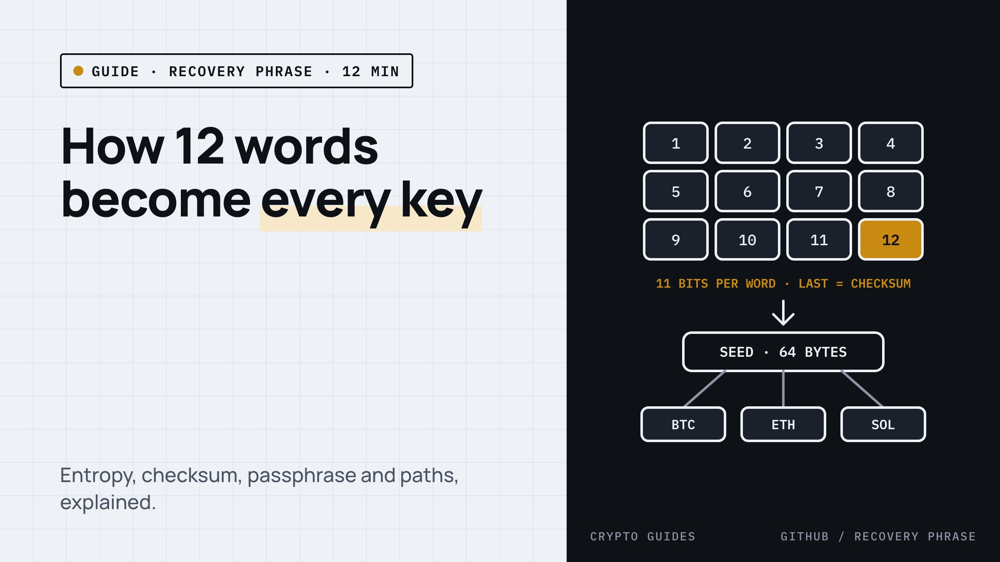
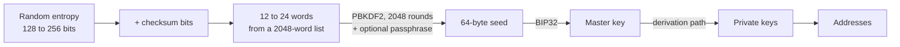

# Seed phrase handbook: how 12 words become every key in your wallet

**What a BIP39 recovery phrase really is, how it is built, how to back it up, and how to test the backup without risking anything.**



Your recovery phrase looks like a password. It is not. It is a human-readable encoding of a large random number, and everything your wallet ever does is derived from that number. Understanding the pieces tells you what can go wrong, which backups are good, and why "I restored my phrase and the balance is zero" usually has a boring explanation.

## Contents

- [The short version](#the-short-version)
- [From entropy to words](#from-entropy-to-words)
- [The checksum word](#the-checksum-word)
- [From words to keys](#from-words-to-keys)
- [The passphrase, or "25th word"](#the-passphrase-or-25th-word)
- [Derivation paths: BIP32, BIP44, BIP84](#derivation-paths-bip32-bip44-bip84)
- [12 or 24 words?](#12-or-24-words)
- [Backup strategies](#backup-strategies)
- [What never to do](#what-never-to-do)
- [Testing a backup safely](#testing-a-backup-safely)
- [Sources](#sources)

## The short version



- The words are not the secret's *source*. The random number is. The words are a way to write that number down.
- The same phrase can restore many chains, because the seed is turned into different keys by different *paths*.
- Anyone with the phrase has the funds. Anyone without it cannot be helped, not even by the wallet's authors.

## From entropy to words

BIP39 starts from random bytes called **entropy**. The allowed sizes and their word counts:

| Entropy | Checksum | Total bits | Words |
|---|---|---|---|
| 128 bits | 4 bits | 132 | 12 |
| 160 bits | 5 bits | 165 | 15 |
| 192 bits | 6 bits | 198 | 18 |
| 224 bits | 7 bits | 231 | 21 |
| 256 bits | 8 bits | 264 | 24 |

The combined bit string is cut into groups of **11 bits**. Each group is a number from 0 to 2047, and that number selects a word from the **2048-word list**. That is where 11 comes from: 2^11 = 2048.

The English list has useful properties: the first four letters identify each word, so a backup that stores only the first four letters is still unambiguous, and the words are chosen to be easy to tell apart when written by hand.

The entropy must come from a proper random source. A phrase picked by a human ("random" words, a song lyric, dice rolled once) has far less real entropy than the word count suggests.

<details>
<summary>Worked example with a public test vector</summary>

This is one of the official BIP39 test vectors, not a wallet. Never use it for funds, because everyone knows it.

```
entropy   : 00000000000000000000000000000000   (128 bits, all zero)
SHA-256   : 374708ff...                         (first 4 bits: 0011)
bits      : 128 zero bits + 0011
groups    : eleven groups of 00000000000 (index 0 = "abandon"),
            then 00000000011 (index 3 = "about")
phrase    : abandon abandon abandon abandon abandon abandon
            abandon abandon abandon abandon abandon about
```

The ending "about" is the checksum showing up inside the last word.

</details>

## The checksum word

The last word of a phrase is special. In a 12-word phrase it holds **7 bits of entropy and 4 bits of checksum**. The checksum is the first 4 bits of the SHA-256 hash of the entropy.

What this gives you:

- If you mistype or swap a word, the checksum usually fails and a wallet can say "invalid phrase". For 12 words, about 15 of 16 random mistakes are caught.
- If you only know the first 11 words, only **128** of the 2048 words are valid as the 12th. It is a typo check, not a lock.
- It protects against *typos*, not against theft. Anyone who has a valid phrase has a valid phrase.

You can see this computed step by step with a small script that uses only the public test vectors in the companion gist `bip39_checksum_demo.py`. It refuses real phrases on purpose.

## From words to keys

A wallet does not use the words directly. It stretches them into a **seed**:

```
seed = PBKDF2-HMAC-SHA512(
         password   = the mnemonic sentence (UTF-8),
         salt       = "mnemonic" + passphrase,
         iterations = 2048,
         length     = 64 bytes)
```

Then [BIP32](https://github.com/bitcoin/bips/blob/master/bip-0032.mediawiki) turns the seed into a master key (HMAC-SHA512 with the key `"Bitcoin seed"`) and a tree of child keys. A *derivation path* is an address in that tree.

Two details people miss:

- The wallet does not store a list of addresses. It re-derives them. That is why one phrase can restore everything.
- The mapping from words to seed does not depend on the wordlist's language, only on the exact words. But a different wallet must apply the same rules (same passphrase, same path), or it will derive different keys from the same words.

## The passphrase, or "25th word"

BIP39 lets you add an optional passphrase. It becomes part of the salt, so a different passphrase gives a completely different seed, and therefore completely different wallets.

- **There is no wrong passphrase.** Every string produces a valid wallet. An incorrect passphrase simply opens a different, empty wallet. No error appears.
- It can protect against someone who finds your written phrase, because the phrase alone then opens only an empty wallet.
- It can also destroy your own access: if you forget it, nothing can recover it.
- Treat the passphrase as part of the backup. Store it separately from the phrase. Test it.
- It is not the same as the wallet's lock PIN, and not the same as a hardware wallet's PIN.

## Derivation paths: BIP32, BIP44, BIP84

A path looks like this:

```
m / purpose' / coin_type' / account' / change / address_index
```

| Path | What it is |
|---|---|
| `m/44'/0'/0'/0/0` | Bitcoin, legacy address (BIP44) |
| `m/84'/0'/0'/0/0` | Bitcoin, native SegWit address starting `bc1q` (BIP84) |
| `m/44'/60'/0'/0/0` | Ethereum, and by convention EVM networks |

The `coin_type` numbers are registered in [SLIP-0044](https://github.com/satoshilabs/slips/blob/master/slip-0044.md). The apostrophe means *hardened* derivation. A full table for Bitcoin, Ethereum, Solana, Tron, Litecoin and a note about Monero is in the companion gist `derivation-paths.md`.

Why this matters for backups: if two wallets use different paths, the same phrase shows different addresses. The funds are not gone. Try the other path. Note which wallet you used.

Not every chain follows this. Monero, for example, has its own 25-word recovery phrase and a different key structure, so a BIP39 phrase is not a Monero backup by itself unless the wallet explicitly derives one from it.

## 12 or 24 words?

| | 12 words | 24 words |
|---|---|---|
| Entropy | 128 bits | 256 bits |
| Brute force | not feasible with any known technology | not feasible, with more margin |
| Effort to back up | less writing, fewer mistakes | twice the writing |
| Typical use | many mobile wallets | hardware wallets and some mobile wallets |

The honest answer: both are far beyond brute force. A 128-bit search is not realistic for anyone. The common secp256k1 curve used by Bitcoin and Ethereum offers roughly 128 bits of security anyway, so 24 words does not make the chain's own keys twice as strong. The extra length is margin against weaknesses nobody expects today, such as future cryptanalysis or flaws in randomness.

The real risks are elsewhere: a phrase that was photographed, typed into a website, or written once and lost. A 12-word phrase kept well beats a 24-word phrase kept badly. Some wallets, [Tint Wallet](https://tint.top/wallet/) among them, create 24-word phrases and also accept 12- or 24-word phrases made elsewhere.

## Backup strategies

| Method | Good for | Weakness |
|---|---|---|
| Paper, by hand | the first copy; testing | fire, water, fading, mice |
| Metal plate (stamped or letter tiles) | savings, long term | cost, mistakes while stamping; check the metal type |
| Two copies in two places | any real amount | each place is another thing to protect |
| Shamir splits ([SLIP-39](https://github.com/satoshilabs/slips/blob/master/slip-0039.md)) | larger sums, families | needs wallets that support it; more complex to recover |
| Passphrase on top | extra layer | forgetting it loses everything |

A good default for savings: one handwritten copy made at creation and verified, one metal copy kept in a different place, and a separate note of the wallet name and the passphrase, if any, stored elsewhere.

- Write in block letters. Use the first four letters if the metal plate is small, but number every word.
- Use stainless steel or titanium; soft metals such as aluminium can melt in a house fire.
- Keep the copy dry, away from heat and from curious people.

## What never to do

| Never | Why |
|---|---|
| Photograph it or scan it | photos sync to the cloud and to other devices |
| Store it in cloud notes, email or chat | accounts get breached |
| Type it into a website, a "validator" or a "recovery tool" | this is how phishing works |
| Give it to support, a "helper", or anyone who writes to you first | real support never asks |
| Split it into halves yourself | each half leaks information and either loss kills recovery |
| Use a phrase someone else created for you | they have a copy |
| Pick the words yourself | human choices are guessable |
| Rely on memory alone | memory fails, and so do people |

On splitting: with a 12-word phrase, giving someone six words leaves them roughly 66 bits to guess instead of 128. That is a huge reduction in safety, and you also lose the ability to recover if one half is lost. If you need to split, use a standard scheme such as SLIP-39.

## Testing a backup safely

A backup that has never been restored is a hope. A safe test:

- [ ] **Test with a new, empty wallet** (a second device or a fresh install), before the real wallet holds funds. Or test with a very small amount.
- [ ] **Restore the phrase** from your written copy only, not from the phone it came from.
- [ ] **Compare the first receiving address** with the original wallet's. They must match exactly.
- [ ] **Test the passphrase too**, if you use one: the address must match with the passphrase, and differ without it.
- [ ] **Wipe the test device** afterwards, and delete the test wallet.
- [ ] **Never type your real phrase into a computer you do not control**, a website, or a script. Use the wallet app itself.
- [ ] **Repeat once a year**, or after moving or changing the storage place.

Some wallets also have a built-in "verify your backup" step, which asks for a few words. Use it, and remember it checks your writing, not the metal copy elsewhere.

## Sources

- [BIP39: Mnemonic code for generating deterministic keys](https://github.com/bitcoin/bips/blob/master/bip-0039.mediawiki), with the official [English wordlist](https://github.com/bitcoin/bips/blob/master/bip-0039/english.txt)
- [BIP32: Hierarchical deterministic wallets](https://github.com/bitcoin/bips/blob/master/bip-0032.mediawiki)
- [BIP44: Multi-account hierarchy](https://github.com/bitcoin/bips/blob/master/bip-0044.mediawiki)
- [BIP84: Native SegWit derivation](https://github.com/bitcoin/bips/blob/master/bip-0084.mediawiki)
- [SLIP-0044: Registered coin types](https://github.com/satoshilabs/slips/blob/master/slip-0044.md)
- [SLIP-0039: Shamir's Secret Sharing for mnemonic codes](https://github.com/satoshilabs/slips/blob/master/slip-0039.md)
- [Official BIP39 test vectors](https://github.com/trezor/python-mnemonic/blob/master/vectors.json)

---
Contributions and corrections are welcome — open an issue or a pull request.
License: CC BY 4.0. *Prepared with input from the Tint Wallet team.*
